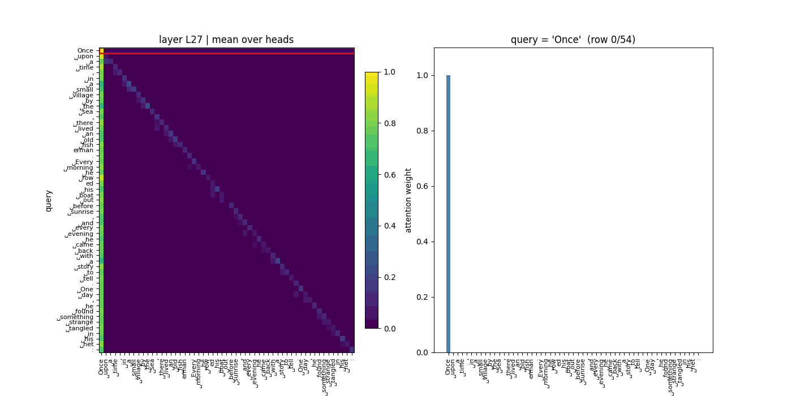
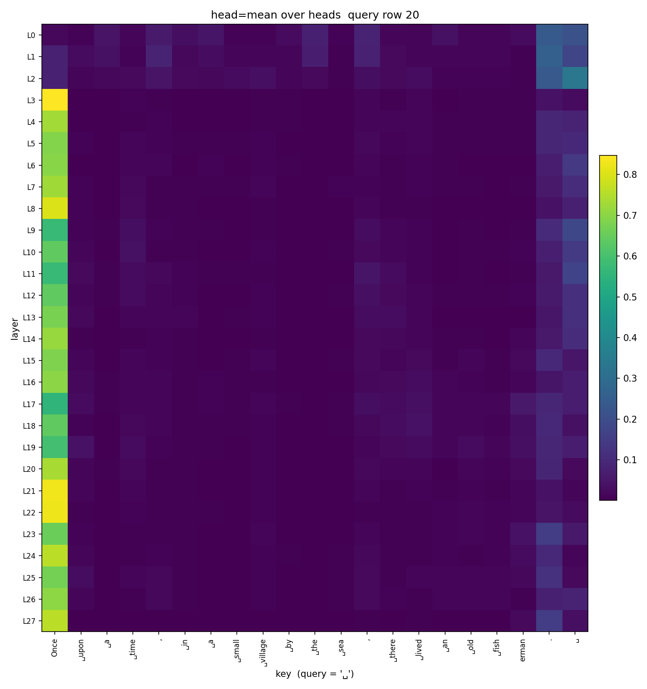
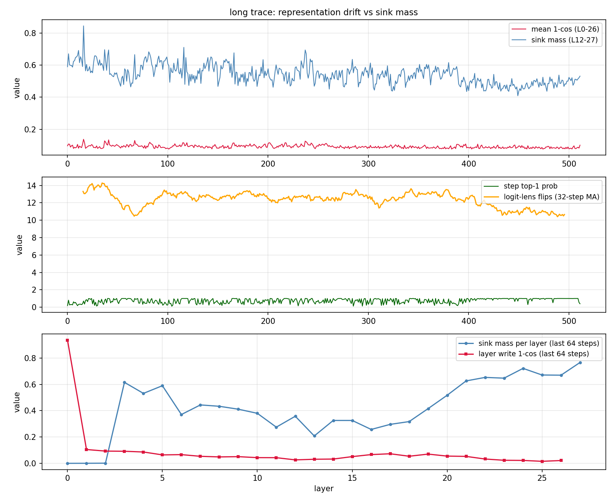
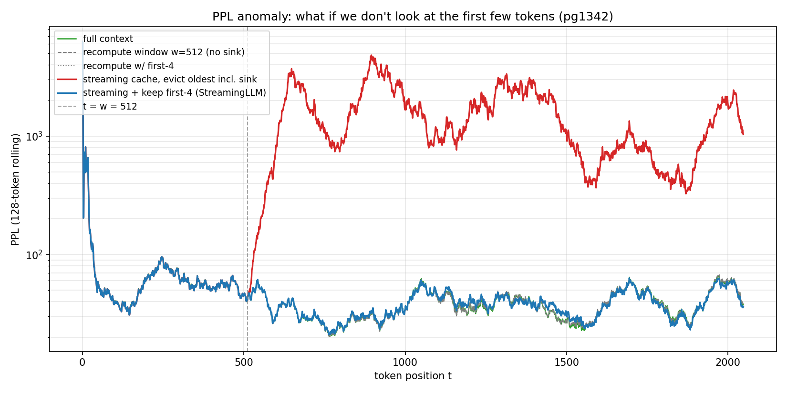
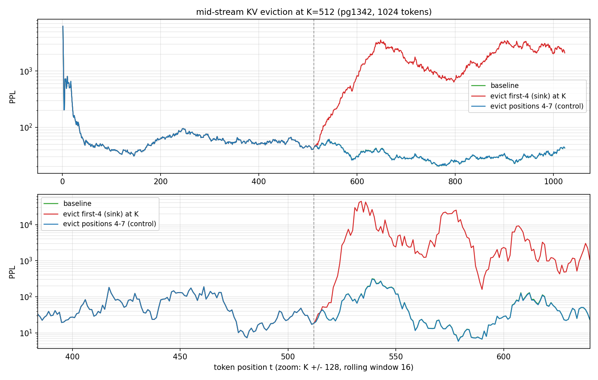

# Attention Sink 可视化与复现

在大模型注意力矩阵里观察 **Attention Sink**（注意力汇）：为什么模型总把大量注意力
倾倒给序列的第一个 token，以及这个现象对 PPL 的实际影响。

本仓库是博客配套代码的最小可复现版本，模型为 **Qwen3-0.6B**
（28 层 / hidden 1024 / 16 个注意力头 / 8 个 KV 头）。

> 开源地址：待补充（GitHub / Gitee）。

## 快速开始

```bash
git clone <repo-url>
cd attention_sink_visualization
python -m venv .venv
source .venv/bin/activate        # Windows: .venv\Scripts\activate
pip install -r requirements.txt
```

模型默认从 Hugging Face 加载 `Qwen/Qwen3-0.6B`。如需使用本地权重，任选一种方式：

```bash
# 方式一：环境变量
export MODEL_PATH=/path/to/Qwen3-0.6B      # Windows: $env:MODEL_PATH="<本地模型目录>"

# 方式二：仓库根目录 .env（已被 .gitignore 忽略）
cp .env.example .env
# 编辑 .env: path_model=/path/to/Qwen3-0.6B
```

需要加载模型的脚本都支持 `--model` 覆盖以上配置；纯离线分析脚本（如
`find_heads.py`、`view.py`）只读 npz，不需要模型路径。

先做一次路径自检（不需要加载完整权重）：

```bash
python scripts/preflight.py
python scripts/preflight.py --check-tokenizer   # 额外检查 tokenizer 与序列长度
```

## 复现管线

以下命令都在仓库根目录执行；脚本内部的默认输出目录锚定在
`attention_sink/results/`，与当前工作目录无关。

```bash
# ① 导出 28 层注意力（默认 21 token，末位空格作为预测位置）
python attention_sink/extract_attn.py --layers all --out attention_sink/results/attn.npz

# ② 扫描 worker / sink 头
python attention_sink/find_heads.py

# ③ 单头热图、层×token 扫描图、动画
python attention_sink/view.py single attention_sink/results/attn.npz attention_sink/results/L2_H6_worker.png --layer 2 --head 6
python attention_sink/view.py single attention_sink/results/attn.npz attention_sink/results/L8_H4_sink.png --layer 8 --head 4
python attention_sink/view.py single attention_sink/results/attn.npz attention_sink/results/L15_H7_full.png --layer 15 --head 7
python attention_sink/view.py sweep attention_sink/results/attn.npz attention_sink/results/sweep_last.png --query -1
python attention_sink/view.py layer-animate attention_sink/results/attn.npz attention_sink/results/along_layers.gif --query -1

# ④ hidden states + Logit Lens（21 token：末位空格就是预测位置）
python attention_sink/extract_attn.py --layers all --hidden --out attention_sink/results/attn_hidden.npz
python attention_sink/analyze_hidden.py
#    旧版 20-token hidden 导出：加 --no-tail-space；此时末位是标点，不是预测槽

# ⑤ 长序列逐 token 追踪（512 步，上下文到 563 token）
python attention_sink/long_trace.py --max-new 512
python attention_sink/analyze_long.py
python attention_sink/sublayer_writes.py

# ⑥ 滑窗 PPL：重算 vs 流式驱逐
python attention_sink/window_ppl.py --max-tokens 2048 --window 512

# ⑦ 中途驱逐：删掉头 4 个 token 的 KV，对照删位置 4-7
python attention_sink/sink_evict.py --max-tokens 1024 --evict-at 512

# ⑧ 前置实验：注意力即检索
python attention_sink/secret_word.py
```

想一次跑完，可使用 `scripts/reproduce.ps1`（Windows）或 `scripts/reproduce.sh`。

## 实测结果（Qwen3-0.6B）

| 实验 | 结果 |
|---|---|
| Worker / Sink 分工 | L2/H6 中间内容权重 0.9077；L8/H4 首 token 权重 0.9961 |
| 层×token 扫描 | L0–L2 首列几乎全暗，L3 起出现贯穿到 L27 的亮柱 |
| 长序列 | 512 步后上下文 563 token；首 token 范数 L2=18.2 → L3=**6544.9** 后锁死 |
| 深层 sink（64 步均值） | 0.59 → 0.49，单步峰值 0.845 |
| 滑窗 PPL（pg1342，w=512） | full 33.19 / 重算 32.99 / 流式驱逐 **2090.41** / 流式+保留头 4 个 33.53 |
| 中途驱逐 PPL（K=512） | baseline 49.79 / 删头 4 个 **6118.95** / 删 4–7 对照 49.08 |

## 结果预览

**长故事注意力动画**：完整三句渔夫故事（55 token），固定末层 L27、16 头平均，
按 query 逐行播放。可以看到首列 sink 与对角线附近的局部注意力。



**层 × token 扫描**：28 层 × 21 token，横轴为被关注的 token。



**长序列追踪**：512 步、上下文 563 token。上为表示漂移与深层 sink 质量，
中为 top-1 概率与 Logit Lens 翻转，下为最后 64 步的逐层分布。



**干预实验一：滑窗 PPL**。流式驱逐包含 sink 时在 t=512 后爆炸；
窗口重算或永久保留头 4 个 token 都能维持稳定。



**干预实验二：中途驱逐**。K=512 时删除 KV：删头 4 个 token 后 PPL 爆炸，
删除位置 4–7 的等量对照则与 baseline 接近。



详细解读见博客（链接待补充）。

## 目录结构

```text
.
├─ attention_sink/
│  ├─ common.py              # 模型路径解析、权重定位、模型加载
│  ├─ extract_attn.py        # 一次前向导出 attention / hidden states
│  ├─ find_heads.py          # worker / sink head 扫描
│  ├─ view.py                # 热度图与动画
│  ├─ analyze_hidden.py      # hidden 演化 + Logit Lens
│  ├─ long_trace.py          # 长序列逐 token 追踪
│  ├─ analyze_long.py        # 漂移 / sink / logit lens 离线分析
│  ├─ sublayer_writes.py     # attention vs MLP 残差增量拆分
│  ├─ window_ppl.py          # 滑窗重算 vs 流式驱逐 PPL
│  ├─ sink_evict.py          # 中途驱逐头 4 个 token 的因果实验
│  ├─ secret_word.py         # 注意力即检索的前置实验
│  └─ pg1342.txt             # Project Gutenberg #1342（公版文本）
├─ scripts/
│  ├─ preflight.py           # 路径 / 数据 / 依赖自检
│  ├─ reproduce.ps1
│  └─ reproduce.sh
├─ assets/                    # README 展示图（attn.gif / sweep / 长序列 / 干预实验）
├─ requirements.txt
├─ .env.example
└─ LICENSE                  # Apache-2.0
```

`attention_sink/results/` 是运行时输出目录，已被 `.gitignore` 忽略。

## 数据与许可

- `attention_sink/pg1342.txt`：Project Gutenberg eBook #1342 *Pride and Prejudice*，
  公版文本，来源 <https://www.gutenberg.org/ebooks/1342>。
- 代码遵循仓库根目录 `LICENSE`（Apache-2.0）。
- 模型权重遵循 Qwen3-0.6B 自身的 Apache-2.0 许可。

## 环境说明

开发与验证环境：Python 3.11、torch 2.3.1、transformers 4.57.6、numpy 1.23.5。
`transformers` 需要支持 `dtype=` 与新版 `DynamicCache`，建议 `>=4.56`。

显存参考：Qwen3-0.6B 的 bf16 权重约 1.5 GB；2048 token 整段前向和
563 token 长序列的显存需求随 dtype / 实现变化，通常单张消费级显卡即可跑。
